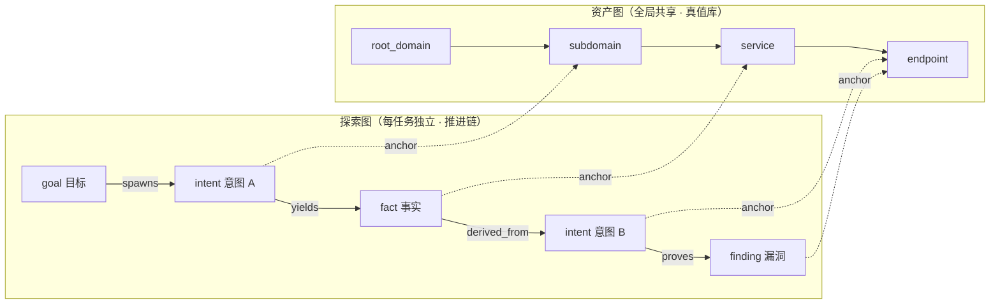
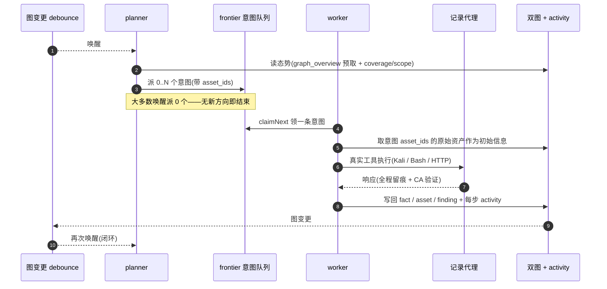
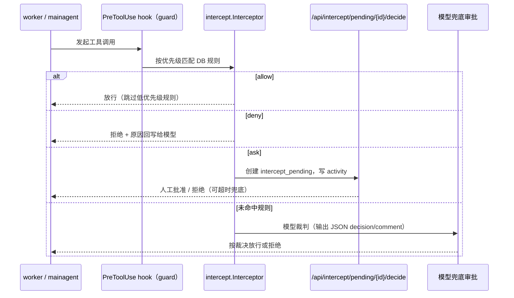
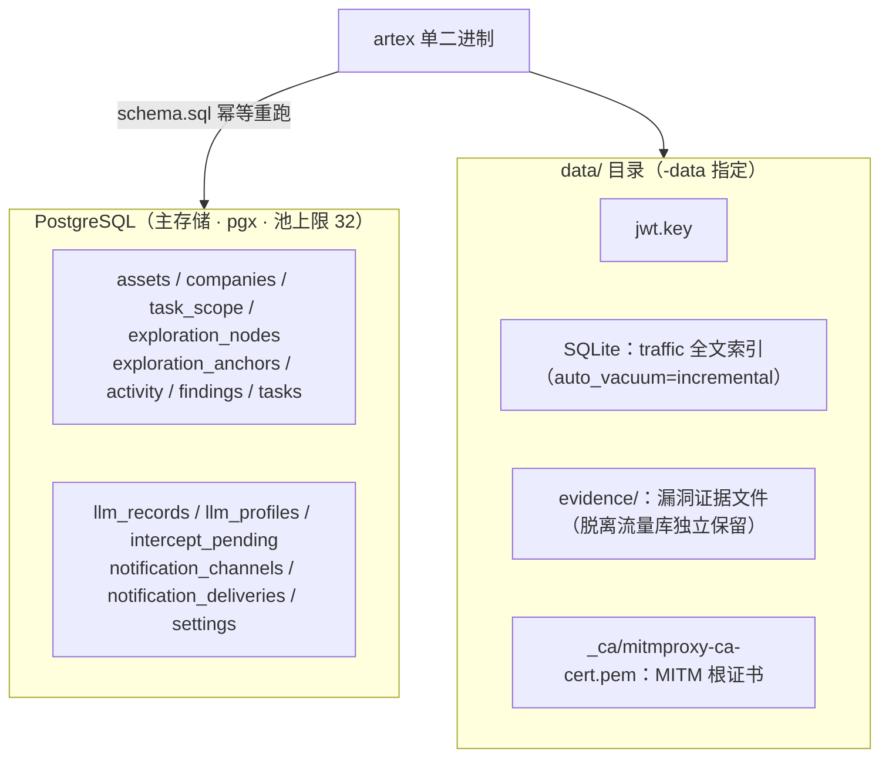

<div align="center">

> [English](./README_en.md) | **简体中文**


# ART-bak — ARTEX AI 自主渗透测试系统（源码备份）

**ARTEX 最终版本的完整源码快照：LLM 多 Agent 驱动的自主渗透平台（Go 后端 + Next.js 前端 + PostgreSQL）。**


</div>

---

## 它解决什么问题

**ARTEX** 是一套 **LLM 多 Agent 驱动的自主渗透测试系统**：给它一个测试目标与范围，由 goals / planner / worker / mainagent 四类 Agent 协作完成探索——planner 事件驱动地派发意图、worker 用真实工具执行并把发现写回两张图（资产图 + 探索图）、mainagent 负责人与系统的对话与干预。配套能力包括 MITM 流量留痕、工具调用拦截审批、漏洞证据库、多渠道 IM 推送与报告生成。

**本仓库（ART-bak）的性质**：这是 ARTEX **最后一个版本的纯源码备份**（快照时间为 v0.3.15，2026-10-07）。上游仓库 `github.com/Autumn-27/ARTEX` 与 Docker 部署源可能已失效，因此**本地源码构建是唯一可靠的安装方式**（见快速开始）。本仓不做功能开发，仅保证代码可编译、可审阅、可追溯。

> ⚠️ 本系统会对目标发起真实请求。请只在获得**书面授权**的资产范围内使用。

🌐 界面效果可参考在线 Demo：[https://artex-demo.vercel.app/](https://artex-demo.vercel.app/)

---

## 截图预览

| 仪表盘 | 探索链路图 |
| :---: | :---: |
|  |  |

| 资产覆盖图 | 拦截审批 |
| :---: | :---: |
|  |  |

| 流量录制 | 人在环路对话 |
| :---: | :---: |
|  |  |

---

## ✨ 功能

- **双图架构**：资产图（全局共享真值库：`root_domain / subdomain / ip / service / app / endpoint`）与探索图（每任务独立推进链：`goal / intent / fact / finding / hint / digest`）通过 `exploration_anchors` 锚点相连，支撑资产测试覆盖度统计与力导向覆盖图。
- **事件驱动的 planner/worker 引擎**：图变更经 debounce 唤醒 planner，派意图进 frontier，N 个 worker（默认 3）各自领取一条意图执行并写回，写回再触发下一轮，直到 `prove_goal`。
- **worker 间过程级信息交换**：`search_all_worker_traces` / `list_worker_traces` / `get_worker_trace` 让后续 worker 检索他人执行过程中未写成 fact 的观察。
- **planner 共享 todolist**：跨唤醒常驻的规划待办，让"注入点 → 凭据 → 横向 → 提权"这类串行攻击链按依赖逐轮推进、不重复不错序。
- **工具调用拦截（人在环路）**：DB 可配置的 `allow / deny / ask` 规则（含内置「删除类接口路径」等破坏性规则）+ 模型兜底审批；全局/任务级资产拦截黑白名单（默认拦 `.gov` `.edu` 等）。
- **MITM 流量留痕**：内嵌 go-mitmproxy 录制代理（默认 `127.0.0.1:8788`），全量明文落文件树 + SQLite 全文索引；漏洞可绑定多条流量证据到独立证据库。
- **LLM 治理**：多 profile 链式 failover（llmpool）、五层重试、全量 LLM 请求/响应录制入库（llmrec）、token 用量计量。
- **通知推送**：钉钉 / 飞书 / 企业微信 / 通用 Webhook / Telegram / 邮件六渠道，实时与汇总两种模式，凭据掩码 + SSRF 防护。
- **MCP 与 skills**：远程 MCP 支持 Streamable HTTP 与旧版 SSE；内置 `api-recon`、`playwright-cli`、`scopesentry` 三个 skill，支持从 [ScopeSentry](https://github.com/Autumn-27/ScopeSentry) 同步资产。
- **交付与运维**：Markdown 漏洞报告、任务归档包、页面一键自更新（SHA256SUMS 校验 + 冒烟 + 失败自动回滚到 `artex.old`）。

---

## 🚀 快速开始

> **环境要求**：Go ≥ 1.26、Node.js + npm、PostgreSQL ≥ 14（可用 Docker 起）、至少一个 LLM API Key（Anthropic 或 OpenAI 兼容端点）。

### 方式一：面向 AI Agent（一键提示词，推荐）

把下面这段原样发给本地 AI Agent（Claude Code / Cursor / Devin 等）：

````markdown
请帮我在本机编译并运行 ARTEX（AI 自主渗透测试系统，Go + Next.js 源码备份）：

1. 克隆 https://github.com/RayMorTwinkle/ART-bak 到本地并进入目录。
2. 准备 PostgreSQL：如果本机没有可用实例，用 `docker run -d --name artex-pg -e POSTGRES_USER=artex -e POSTGRES_PASSWORD=<随机密码> -e POSTGRES_DB=artex -p 5432:5432 postgres:16-alpine` 起一个。
3. 复制 `config.example.json` 为 `config.json`，填入上面的 database 连接信息（或直接导出环境变量 `ARTEX_PG_DSN`）。
4. 构建前端：`cd web && npm ci && npm run build:static && cd ..`，然后 `cp -r web/out server/webui/dist`。
5. 编译后端：`CGO_ENABLED=0 go build -tags embedui -o artex ./cmd/artex`。
6. 配置 LLM：导出 `ANTHROPIC_API_KEY` 或 `OPENAI_API_KEY`（也可启动后在 UI「LLM 配置」页填）。
7. 用 `./start.sh` 启动（Windows 用 `start.bat`），打开 http://localhost:8787 ，首次进入 `/setup` 设置管理员密码。

每步验证成功再进入下一步，报错先读日志定位。
````

### 方式二：面向人类用户

```bash
git clone https://github.com/RayMorTwinkle/ART-bak.git && cd ART-bak

# 1) 数据库：已有 PG 则跳过；或用 Docker 起一个
docker run -d --name artex-pg \
  -e POSTGRES_USER=artex -e POSTGRES_PASSWORD=change-me -e POSTGRES_DB=artex \
  -p 5432:5432 postgres:16-alpine

# 2) 配置
cp config.example.json config.json   # 填 database 连接（或改用 ARTEX_PG_DSN）

# 3) 前端静态导出 → 拷入内嵌目录
cd web && npm ci && npm run build:static && cd ..
cp -r web/out server/webui/dist

# 4) 编译单二进制（-tags embedui 才内嵌前端）
CGO_ENABLED=0 go build -tags embedui -o artex ./cmd/artex

# 5) 启动（守护脚本，更新换装靠它）
export ANTHROPIC_API_KEY=sk-...        # 或 OPENAI_API_KEY
./start.sh                           # → http://localhost:8787
```

> **为什么用 `start.sh` 而不是直接 `./artex`**：它是守护脚本——程序退出后按退出码决定是否重新拉起（自更新换装协议依赖它）。后台常驻：`nohup ./start.sh >artex.log 2>&1 &`。

---

## 🖥️ 使用

### 启动参数（`./start.sh` 原样透传给 `artex`）

| 参数 | 默认 | 说明 |
| --- | --- | --- |
| `-addr` | `:8787` | HTTP 监听地址：前端静态页 + REST `/api/*` + SSE 活动流同一端口 |
| `-proxy` | `127.0.0.1:8788` | 流量录制 MITM 代理地址；置空则关闭录制 |
| `-data` | 可执行文件同级 `data/` | 数据目录（jwt.key、SQLite 索引、证据文件等） |

### 配置文件（`config.json`，可执行文件同级；`ARTEX_CONFIG` 可改路径）

```json
{
  "database": { "host": "127.0.0.1", "port": 5432, "user": "artex",
                "password": "yourpass", "dbname": "artex", "sslmode": "disable" },
  "skill_dir": "/opt/artex/skills"
}
```

`database.dsn` 完整连接串写法优先于分字段；环境变量优先级：`ARTEX_PG_DSN` > `database`、`ARTEX_SKILL_DIR` > `skill_dir`。

### LLM 与常用环境变量

`ANTHROPIC_API_KEY` / `OPENAI_API_KEY` / `ARTEX_LLM_PROVIDER` / `ARTEX_LLM_MODEL` / `ARTEX_LLM_BASE_URL` / `ARTEX_LLM_PROXY`（均可在 UI 里配置）。

### 典型工作流

```text
创建任务（目标 + 范围）→ goals 拆解目标 → planner/worker 自主探索
  → 拦截审批（人在环路放行高危操作）→ findings 复核/复测
  → 关联流量证据 → 生成 Markdown 报告 / 任务归档
```

### 反向代理部署

前端与 API/SSE 同端口（`:8787`），活动流默认同源、无需 `NEXT_PUBLIC_SSE_BASE`；公网只开 443 即可。SSE 反代**必须关缓冲**：`proxy_buffering off; proxy_read_timeout 3600s; proxy_http_version 1.1;`。

### 更新升级（针对有可获取新版的场景）

升级只换程序不动数据：`pgdata`、`./data`（jwt.key / SQLite）、`./skills` 均保留；`artex` 每次启动幂等重跑内嵌 `schema.sql`（重启即迁移）。本备份仓不再发版，页面自更新通道指向上游 GitHub Releases，可能已不可用。

### 开发

```bash
./dev.sh      # 后端(:8787) + 流量代理(:8788) + next dev(:5173)
go test ./... # 后端测试
cd web && NEXT_PUBLIC_MOCK=1 npm run dev   # 无后端 mock 预览
```

---

## 🏗️ 架构

### 系统总览

```mermaid
flowchart TB
  subgraph FE["前端 Next.js（go:embed 内嵌单二进制）"]
    UI["仪表盘 · 任务 · 资产 · 覆盖图 · 流量 · 工作空间 · 系统配置"]
  end
  subgraph SRV["server（Go net/http）"]
    API["REST /api/*　JWT 鉴权　SSE"]
    ENG["engine 调度循环"]
    MGR["Manager　任务/引擎/store 生命周期"]
  end
  subgraph AG["agent（norma SDK）"]
    GO["goals　目标分解 + 提取范围"]
    PL["planner　规划者（唯一意图生成者）"]
    WK["worker　执行者 ×N"]
    MA["mainagent　人在环路"]
  end
  subgraph DB["PostgreSQL"]
    AGRAPH["资产图　assets / companies / task_scope"]
    EGRAPH["探索图　exploration_nodes / anchors / activity"]
  end
  subgraph SUB["支撑子系统"]
    PROXY["traffic　MITM 记录代理 + CA"]
    GUARD["guard / intercept　工具审批门"]
    ENR["enrich　DNS / HTTP 异步补全"]
    EXT["mcphttp · skills · llmpool · notify · report"]
  end

  UI -->|HTTP| API
  API --> MGR --> ENG
  ENG --> PL
  ENG --> WK
  API --> MA
  API --> GO
  PL --> DB
  WK --> DB
  MA --> DB
  GO --> DB
  WK -->|"Bash / HTTP 全程留痕"| PROXY
  WK --> GUARD
  WK --> ENR
  PL -.-> EXT
  WK -.-> EXT
  MA -.-> EXT
```



| 层 | 职责 |
| --- | --- |
| **前端** | Next.js 静态导出，`go:embed` 内嵌进单二进制；可视化任务/资产/探索链路/覆盖图，人在环路对话 |
| **server** | `net/http` 路由 + JWT 鉴权 + SSE；`Manager` 托管任务、引擎、DB store 生命周期 |
| **engine** | 每任务一个 plannerLoop + N 个 worker goroutine；意图领取、超时/暂停/drain |
| **agent** | goals / planner / worker / mainagent，ToolSet 把双图暴露成 LLM 工具 |
| **db** | 双图的 Postgres 落地（pgx）；`schema.sql` 经 `go:embed` 每次启动幂等建表 |
| **支撑** | 记录型 MITM 代理、审批门、异步补全、MCP/技能/LLM 池/通知/报告 |

### 双图架构：探索图 + 资产图

- **资产图（全局共享）**：跨任务同一份资产真值库，归属公司；域名→子域→服务→端点的父子关系与去重 key 由程序计算，Agent 只提交原始信息。
- **探索图（每任务独立）**：一次任务的"思考与推进"过程，靠 `spawns / derived_from / yields / proves` 边连成血缘链。
- **锚点相连**：`exploration_anchors(node_id, asset_id)` 把意图/事实/漏洞锚定到具体资产——支撑资产测试覆盖度与覆盖图（范围内资产 + 已测高亮）。



### 引擎与意图生命周期（一次探索的闭环）



### 工具调用拦截（ask 规则 → 人工裁决）



### 存储布局



---

## 📂 目录结构

```text
ART-bak/
├── cmd/artex/          # 入口：flag 解析、自更新引导、HTTP 服务启动
├── server/             # net/http 路由 + JWT + SSE + Manager/engine 调度
├── agent/              # goals / planner / worker / mainagent / 工具目录 / 压缩
├── db/                 # Postgres 访问层 + 内嵌 schema.sql（启动幂等迁移）
├── traffic/            # go-mitmproxy 录制代理 + SQLite 全文索引
├── evidence/           # 漏洞证据独立存储（不随流量清理而丢失）
├── guard/              # PreToolUse 安全边界：审计 + 拦截规则评估
├── intercept/          # allow/deny/ask 拦截规则引擎 + 人工裁决
├── llmpool/            # LLM profile 链式 failover（priority/rank）
├── llmrec/             # llm.Provider 录制装饰器：全量请求/响应入库
├── mcphttp/            # Streamable HTTP / 旧版 SSE 的远程 MCP 客户端
├── notify/             # 钉钉/飞书/企微/Webhook/TG/邮件推送（无状态渠道）
├── enrich/             # 资产异步补全：dnsx 解析 + HTTP 探测（走记录代理）
├── sidequestion/       # /btw 旁路提问服务（不打断主线的问答）
├── report/             # 从探索图渲染 Markdown 漏洞报告
├── selfupdate/         # 一键自更新：SHA256SUMS 校验、暂存、失败回滚
├── config/             # config.json / 环境变量加载
├── skills/             # 内置 skills：api-recon / playwright-cli / scopesentry
├── web/                # Next.js 前端（shadcn/ui，静态导出后内嵌）
├── screenshots/        # 界面截图
├── install.sh / dev.sh / build.sh / update.sh / start.sh / start.bat
├── docker-compose.yml / Dockerfile / config.example.json / .env.example
└── assets/logo.svg     # 仓库图标（沿用 web/public/logo.svg 官方品牌）
```

---

## 🔧 技术细节

- **模块名**：`github.com/Autumn-27/artex`（Go 1.26.3）；Agent 能力由 [`norma`](https://github.com/Autumn-27/norma) v0.4.3 SDK 提供（`agentcore / tool / permission / harness / memory / transcript`）。
- **关键依赖**：`pgx/v5`（Postgres）、`modernc.org/sqlite`（纯 Go SQLite 索引）、`lqqyt2423/go-mitmproxy`（录制代理）、`miekg/dns` + `projectdiscovery/dnsx`（enrich）、`golang-jwt/v5`（鉴权）。
- **构建**：前端 `npm run build:static`（`NEXT_EXPORT=1`）产物 `web/out` 拷至 `server/webui/dist`；`go build -tags embedui` 触发 `//go:embed all:webui/dist`（不带 tag 走 `webui_stub.go`）；`build.sh --release` 出跨平台 zip（`ARTEX_TARGETS` 自定义，`--upx` 可选压缩）。
- **守护协议**：`start.sh`/`start.bat` 按退出码决定是否拉起；`selfupdate.ExitRestart = 75` 触发换装——新二进制先冒烟 `artex -h`，连续 3 次启动失败自动回滚 `artex.old`（失败者留 `artex.failed`）。
- **连接池**：`database/sql` 上限 32 连接、30 分钟寿命、5 分钟空闲淘汰。
- **MITM 代理**：默认只绑 `127.0.0.1:8788`（避免开放代理暴露）；CA 证书在 `data/_ca/mitmproxy-ca-cert.pem`；开启全局出口代理时拦截与透传均走上游，不泄露源 IP。
- **MCP**：远程 MCP 工具命名 `mcp__server__tool`；旧版 SSE 用 `GET /sse` 建流、`/message?sessionId=...` 收 JSON-RPC；HTTP 传输可跳过 TLS 校验；凭据经 env map 传 `{"Authorization":"Bearer …"}`。
- **通知投递**：`FOR UPDATE SKIP LOCKED` 租约领取、令牌桶限流不消耗重试预算、凭据掩码回显、拨号期 SSRF 防护（环回需 `ARTEX_NOTIFY_ALLOW_LOCAL=1`，RFC1918 放行）。
- **拦截默认规则**：内置模糊拦截 `.gov/.gov.cn/.edu/.edu.cn` 资产与 `/delete /del /remove /unlink /erase /destroy` 路径 deny 规则，均可停用/删除。
- **工具输出截断**：统一走 `actool.Capture`，按会话 `MaxOutputChars`（默认 30000）截断，配 `ToolOutputDir` 时溢写磁盘。
- **漏洞复测**：独立 `retester` Agent 会话；结论「已修复」自动同步漏洞处置状态；同一漏洞复用会话。
- **冷节点压缩**：`cold-digest` 折叠长期不活跃意图/事实为 digest（R=6 轮防抖），存储无损可 `expand_digest` 还原；可选实验性 `noa` 模型驱动压缩（默认关）。

---

## ❓ 常见问题

**Q：这个仓库和上游 ARTEX 是什么关系？**
A：这是 ARTEX **最后一个版本（v0.3.15，2026-10-07）的纯源码备份**。上游仓库与 Docker 镜像源可能已失效；本仓不新增功能，只保证源码完整可构建。

**Q：没有 Docker 镜像了还能跑吗？**
A：可以，且源码构建是推荐路径：只需 Go + Node + 一个 PostgreSQL。compose 文件里 `autumn27/artex` 镜像失效时，`docker-compose.yml` 中的 postgres 服务仍可单独用来起数据库。

**Q：启动报数据库连接失败？**
A：`config.json` 必须放在可执行文件同级（或 `ARTEX_CONFIG` 指定），`database` 分字段或 `dsn` 二选一；也可直接导出 `ARTEX_PG_DSN` 完全覆盖。

**Q：反代后活动流一直转圈？**
A：SSE 被缓冲了。Nginx 需 `proxy_buffering off` + `proxy_http_version 1.1` + 长超时；生产构建默认同源 SSE，无需 `NEXT_PUBLIC_SSE_BASE`。

**Q：Agent 会乱打命令吗？**
A：所有工具调用过 `PreToolUse` 拦截门：DB 规则 `allow/deny/ask` + 模型兜底审批 + 资产黑白名单，审批记录可追溯来源到具体会话步骤。

**Q：会再更新吗？**
A：本仓为定格快照，不计划发版；页面自更新指向上游 Releases，不可用时请本地重新构建。

---

## ⚠️ 注意事项

- **授权合规**：ARTEX 会对目标发起真实探测与攻击载荷，仅限**已获得书面授权**的资产；内置 `.gov`/`.edu` 拦截只是默认兜底，不构成授权依据。
- **备份快照性质**：依赖与脚本按快照时点状态保留；上游镜像/发布源失效属预期，请勿把本仓当作活跃上游。
- **敏感数据**：流量留痕为**全量明文**；`data/` 含 jwt.key 与证据文件，注意访问控制与备份保密。
- **更新会中断任务**：一键更新即重启，且数据库结构不回退。
- **Docker 升级只换程序不换镜像**：镜像内 nmap/playwright 等工具链不随自更新升级。

---

## 📄 License

本项目采用 **GNU Affero General Public License v3.0（AGPL-3.0）**，见 [LICENSE](LICENSE)。上游原始许可条款（含允许使用范围与免责声明）同样适用于本备份。

---

## 🙏 致谢

- **上游项目**：[Autumn-27/ARTEX](https://github.com/Autumn-27/ARTEX) —— 本仓为其最终版本源码备份，全部功能与设计归原作者所有。
- **Agent SDK**：[Autumn-27/norma](https://github.com/Autumn-27/norma) v0.4.3。
- **资产同步**：[Autumn-27/ScopeSentry](https://github.com/Autumn-27/ScopeSentry)。
- **审批详情组件参考**：[RuoJi6/AegisHook](https://github.com/RuoJi6/AegisHook)。
- **设计参考**：[oritera/Cairn](https://github.com/oritera/Cairn)。
- 贡献者（上游 CHANGELOG 记录）：@Autumn-27、@RuoJi6、@dingpotian。

<div align="center">
<sub>ART-bak · 定格的自主渗透系统源码快照 — 可编译、可审阅、可追溯</sub>
</div>
