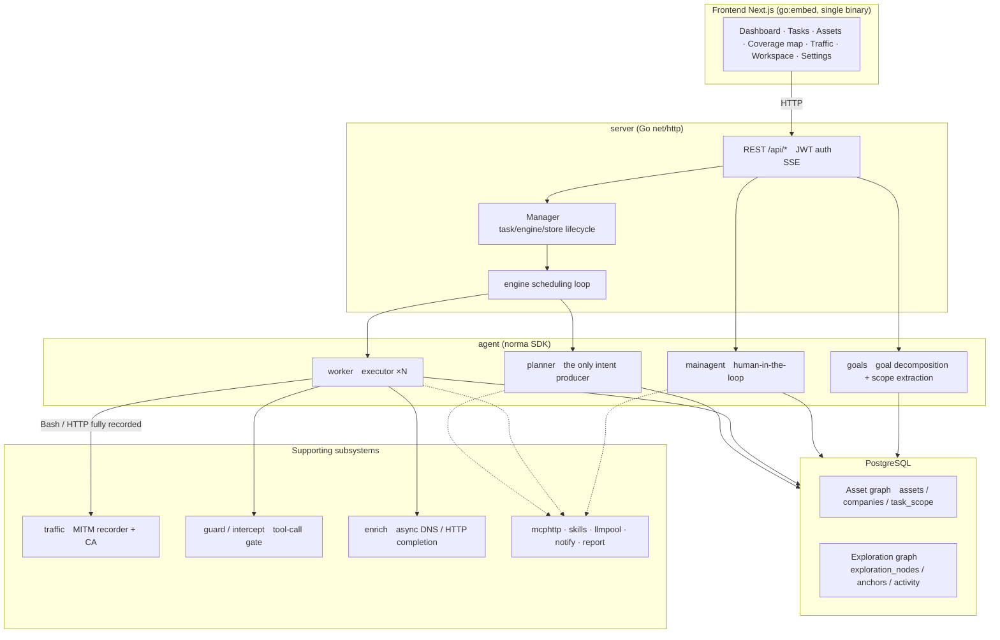
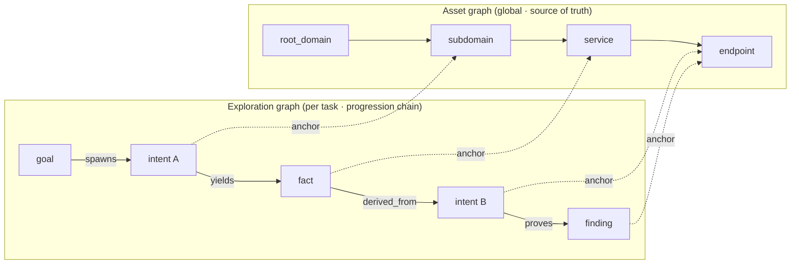
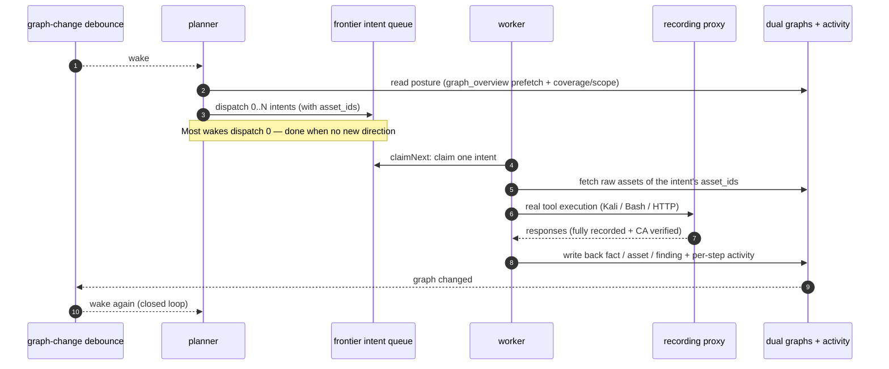
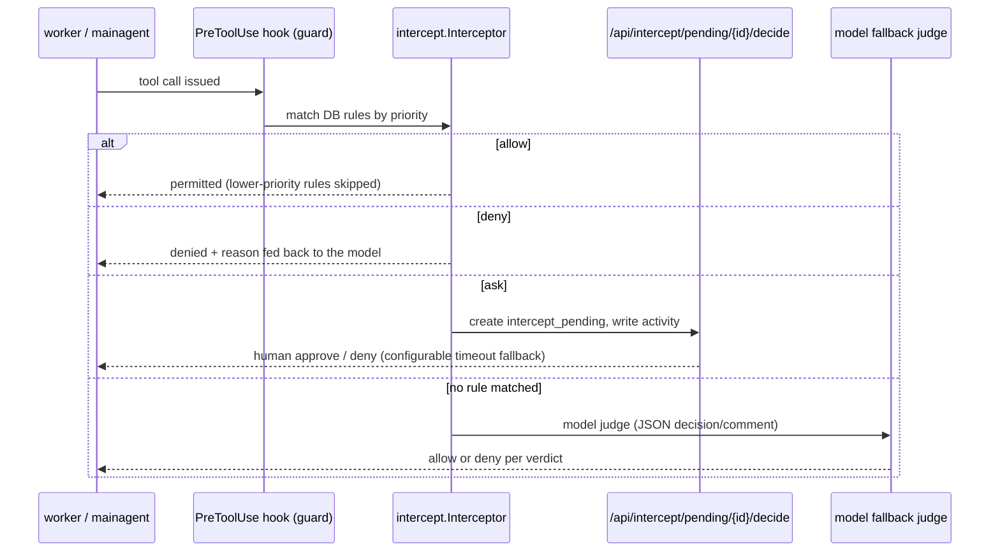
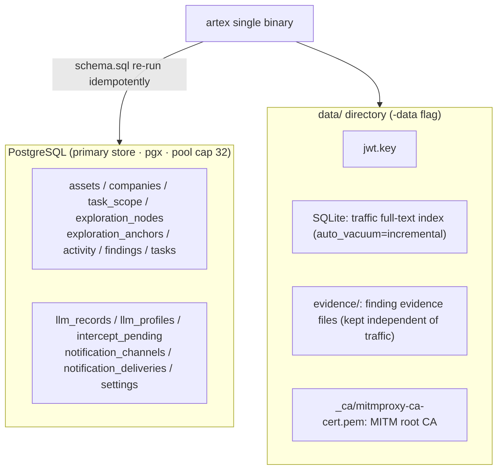

<div align="center">

> **English** | [简体中文](./README.md)


# ART-bak — ARTEX AI Autonomous Pentest System (Source Backup)

**A complete source snapshot of the final ARTEX release: an LLM multi-agent autonomous penetration-testing platform (Go backend + Next.js frontend + PostgreSQL).**


</div>

---

## Why it exists

**ARTEX** is an **LLM multi-agent autonomous penetration-testing system**: give it a target and a scope, and four agent roles — goals / planner / worker / mainagent — collaborate to explore it. The event-driven planner dispatches intents, workers execute with real tools and write results back into two graphs (an asset graph + an exploration graph), and the mainagent handles human-in-the-loop conversation and intervention. Supporting capabilities include a MITM traffic recorder, tool-call interception with human approval, an independent finding-evidence store, multi-channel IM push notifications, and report generation.

**What this repo (ART-bak) is**: a **pure source backup of the final ARTEX version** (snapshot v0.3.15, 2026-10-07). The upstream repository `github.com/Autumn-27/ARTEX` and its Docker image source may be gone, so **building from source is the only reliable way to run it** (see Quick Start). This repo receives no feature development; it exists so the code stays compilable, reviewable, and traceable.

> ⚠️ This system sends real traffic and payloads to targets. Only use it against assets you are **explicitly authorized** to test.

🌐 UI preview: online demo at [https://artex-demo.vercel.app/](https://artex-demo.vercel.app/)

---

## Screenshots

| Dashboard | Exploration graph |
| :---: | :---: |
|  |  |

| Asset coverage map | Intercept approval |
| :---: | :---: |
|  |  |

| Traffic recording | Human-in-the-loop chat |
| :---: | :---: |
|  |  |

---

## ✨ Features

- **Dual-graph architecture**: a globally shared **asset graph** (`root_domain / subdomain / ip / service / app / endpoint`, owned by companies) and a per-task **exploration graph** (`goal / intent / fact / finding / hint / digest`, lineage edges `spawns / derived_from / yields / proves`), linked by `exploration_anchors` — powering per-asset test coverage and the force-directed coverage map.
- **Event-driven planner/worker engine**: graph changes debounce-wake the planner, which pushes intents into a frontier queue; N workers (default 3) each claim one intent, execute, write back — closing the loop until `prove_goal`.
- **Cross-worker trace exchange**: `search_all_worker_traces` / `list_worker_traces` / `get_worker_trace` let workers reuse observations seen in other runs that never became facts.
- **Planner shared todolist**: a per-task, wake-persistent todo list lets multi-step serial exploit chains (e.g. injection → credentials → lateral → privesc) advance in dependency order across planner rounds — no repeats, no reordering.
- **Tool-call interception (human-in-the-loop)**: DB-configured `allow / deny / ask` rules (built-in destructive rules such as delete-path denial) plus a model-fallback judge; global and per-task asset blocklists/allowlists (`.gov` `.edu` blocked by default).
- **MITM traffic capture**: embedded go-mitmproxy recorder (default `127.0.0.1:8788`), full plaintext to a file tree + SQLite full-text index; findings can bind multiple traffic records into an independent evidence store.
- **LLM governance**: chained profile failover (llmpool), five retry layers, full request/response recording to Postgres (llmrec), token usage metering.
- **Notifications**: DingTalk / Feishu / WeCom / generic Webhook / Telegram / Email — realtime or digest modes, credential masking and SSRF guard.
- **MCP & skills**: remote MCP over Streamable HTTP and legacy SSE; built-in `api-recon`, `playwright-cli`, `scopesentry` skills; one-click asset sync from [ScopeSentry](https://github.com/Autumn-27/ScopeSentry).
- **Delivery & ops**: Markdown finding reports, task archive packages, one-click in-app self-update (SHA256SUMS verify + smoke test + auto-rollback to `artex.old`).

---

## 🚀 Quick Start

> **Requirements**: Go ≥ 1.26, Node.js + npm, PostgreSQL ≥ 14 (Docker is fine), and at least one LLM API key (Anthropic or an OpenAI-compatible endpoint).

### Option A — prompt for an AI agent (recommended)

Paste this verbatim to your local AI agent (Claude Code / Cursor / Devin …):

````markdown
Build and run ARTEX on this machine (AI autonomous pentest system, Go + Next.js source backup):

1. Clone https://github.com/RayMorTwinkle/ART-bak and cd into it.
2. Provide PostgreSQL: if none is available, run `docker run -d --name artex-pg -e POSTGRES_USER=artex -e POSTGRES_PASSWORD=<random> -e POSTGRES_DB=artex -p 5432:5432 postgres:16-alpine`.
3. Copy `config.example.json` to `config.json` and fill in the `database` section (or export `ARTEX_PG_DSN` instead).
4. Build the frontend: `cd web && npm ci && npm run build:static && cd ..`, then `cp -r web/out server/webui/dist`.
5. Build the backend: `CGO_ENABLED=0 go build -tags embedui -o artex ./cmd/artex`.
6. Configure the LLM: export `ANTHROPIC_API_KEY` or `OPENAI_API_KEY` (or fill it later in the UI's LLM page).
7. Launch with `./start.sh` (`start.bat` on Windows), open http://localhost:8787, and set the admin password at `/setup` on first visit.

Verify each step before continuing; read logs first when something fails.
````

### Option B — manual

```bash
git clone https://github.com/RayMorTwinkle/ART-bak.git && cd ART-bak

# 1) Database: skip if you already have PostgreSQL; otherwise:
docker run -d --name artex-pg \
  -e POSTGRES_USER=artex -e POSTGRES_PASSWORD=change-me -e POSTGRES_DB=artex \
  -p 5432:5432 postgres:16-alpine

# 2) Config
cp config.example.json config.json   # fill database (or use ARTEX_PG_DSN)

# 3) Static-export the frontend → copy into the embed dir
cd web && npm ci && npm run build:static && cd ..
cp -r web/out server/webui/dist

# 4) Build the single binary (-tags embedui embeds the UI)
CGO_ENABLED=0 go build -tags embedui -o artex ./cmd/artex

# 5) Run under the supervisor script (required by the update protocol)
export ANTHROPIC_API_KEY=sk-...        # or OPENAI_API_KEY
./start.sh                           # → http://localhost:8787
```

> **Why `start.sh` instead of `./artex`**: it is a supervisor script — on exit it reads the exit code to decide whether to relaunch (the self-update swap protocol depends on it). Run persistently: `nohup ./start.sh >artex.log 2>&1 &`.

---

## 🖥️ Usage

### Flags (`./start.sh` passes them through to `artex`)

| Flag | Default | Description |
| --- | --- | --- |
| `-addr` | `:8787` | HTTP listen address: static UI + REST `/api/*` + SSE activity stream on one port |
| `-proxy` | `127.0.0.1:8788` | MITM traffic-recording proxy address; empty disables recording |
| `-data` | `data/` next to the binary | Data directory (jwt.key, SQLite indexes, evidence files, …) |

### Config file (`config.json` next to the binary; override path via `ARTEX_CONFIG`)

```json
{
  "database": { "host": "127.0.0.1", "port": 5432, "user": "artex",
                "password": "yourpass", "dbname": "artex", "sslmode": "disable" },
  "skill_dir": "/opt/artex/skills"
}
```

A full `database.dsn` connection string takes precedence over the split fields. Env priority: `ARTEX_PG_DSN` > `database`, `ARTEX_SKILL_DIR` > `skill_dir`.

### LLM & common env vars

`ANTHROPIC_API_KEY` / `OPENAI_API_KEY` / `ARTEX_LLM_PROVIDER` / `ARTEX_LLM_MODEL` / `ARTEX_LLM_BASE_URL` / `ARTEX_LLM_PROXY` (all also configurable in the UI).

### Typical workflow

```text
Create task (target + scope) → goals decomposition → autonomous planner/worker exploration
  → intercept approvals (human-in-the-loop for risky calls) → finding review / retest
  → bind traffic evidence → generate Markdown report / task archive
```

### Reverse-proxy deployment

UI and API/SSE share one port (`:8787`); the activity stream is same-origin by default — no `NEXT_PUBLIC_SSE_BASE` needed; only port 443 needs to be public. SSE proxies **must disable buffering**: `proxy_buffering off; proxy_read_timeout 3600s; proxy_http_version 1.1;`.

### Upgrading

Upgrades swap the binary only, never the data: `pgdata`, `./data` (jwt.key / SQLite), `./skills` all persist; `artex` re-runs the embedded `schema.sql` idempotently on every start ("restart = migrate"). This backup repo ships no new releases; the in-app updater points at upstream GitHub Releases and may no longer work.

### Development

```bash
./dev.sh      # backend(:8787) + traffic proxy(:8788) + next dev(:5173)
go test ./... # backend tests
cd web && NEXT_PUBLIC_MOCK=1 npm run dev   # mock preview without a backend
```

---

## 🏗️ Architecture

### System overview



| Layer | Responsibility |
| --- | --- |
| **Frontend** | Next.js static export embedded via `go:embed` into a single binary; visualizes tasks/assets/exploration lineage/coverage map; human-in-the-loop chat |
| **server** | `net/http` routing + JWT auth + SSE; `Manager` owns task, engine and store lifecycles |
| **engine** | One plannerLoop + N worker goroutines per task; intent claiming, timeouts, pause/drain |
| **agent** | goals / planner / worker / mainagent; ToolSet exposes both graphs as LLM tools |
| **db** | Postgres landing of both graphs (pgx); `schema.sql` re-run idempotently on every boot via `go:embed` |
| **support** | Recording MITM proxy, approval gate, async enrichment, MCP/skills/LLM pool/notify/report |

### Dual graphs: exploration + asset

- **Asset graph (globally shared)**: one cross-task source of truth, owned by companies; parent-child relations (domain → subdomain → service → endpoint) and dedup keys are computed by code — agents only submit raw observations.
- **Exploration graph (per task)**: the "thinking and progress" of one engagement; `spawns / derived_from / yields / proves` edges form a lineage chain.
- **Anchors connect them**: `exploration_anchors(node_id, asset_id)` pins intents/facts/findings to concrete assets — enabling per-asset coverage metrics and the coverage map (in-scope assets with tested highlighting).



### Engine & intent lifecycle (one exploration loop)



### Tool-call interception (ask rule → human decision)



### Storage layout



---

## 📂 Project layout

```text
ART-bak/
├── cmd/artex/          # entrypoint: flags, self-update bootstrap, HTTP server
├── server/             # net/http routes + JWT + SSE + Manager/engine scheduling
├── agent/              # goals / planner / worker / mainagent / tool catalog / compaction
├── db/                 # Postgres access layer + embedded schema.sql (idempotent at boot)
├── traffic/            # go-mitmproxy recorder + SQLite full-text index
├── evidence/           # independent finding-evidence store (survives traffic cleanup)
├── guard/              # PreToolUse safety boundary: audit + rule evaluation
├── intercept/          # allow/deny/ask rule engine + human adjudication
├── llmpool/            # LLM profile chain failover (priority/rank)
├── llmrec/             # llm.Provider recording decorator: every call persisted
├── mcphttp/            # remote MCP client: Streamable HTTP / legacy SSE
├── notify/             # DingTalk/Feishu/WeCom/Webhook/Telegram/Email (stateless channels)
├── enrich/             # async asset completion: dnsx resolve + HTTP probe (via recorder)
├── sidequestion/       # /btw side questions (non-blocking Q&A alongside the main line)
├── report/             # Markdown finding report rendered from the exploration graph
├── selfupdate/         # one-click update: SHA256SUMS verify, staging, auto-rollback
├── config/             # config.json / env loading
├── skills/             # built-in skills: api-recon / playwright-cli / scopesentry
├── web/                # Next.js frontend (shadcn/ui, static export then embedded)
├── screenshots/        # UI screenshots
├── install.sh / dev.sh / build.sh / update.sh / start.sh / start.bat
├── docker-compose.yml / Dockerfile / config.example.json / .env.example
└── assets/logo.svg     # repo icon (reuses the official web/public/logo.svg brand)
```

---

## 🔧 Technical notes

- **Module**: `github.com/Autumn-27/artex` (Go 1.26.3); agent capabilities come from the [`norma`](https://github.com/Autumn-27/norma) v0.4.3 SDK (`agentcore / tool / permission / harness / memory / transcript`).
- **Key deps**: `pgx/v5` (Postgres), `modernc.org/sqlite` (pure-Go SQLite indexes), `lqqyt2423/go-mitmproxy` (recording proxy), `miekg/dns` + `projectdiscovery/dnsx` (enrich), `golang-jwt/v5` (auth).
- **Build**: `npm run build:static` (`NEXT_EXPORT=1`) emits `web/out` → copy to `server/webui/dist`; `go build -tags embedui` activates `//go:embed all:webui/dist` (without the tag, `webui_stub.go` is used); `build.sh --release` produces cross-platform zips (`ARTEX_TARGETS` to customize, optional `--upx`).
- **Supervisor protocol**: `start.sh`/`start.bat` decide relaunch by exit code; `selfupdate.ExitRestart = 75` triggers the staged swap — the new binary is smoke-tested with `artex -h`, and three consecutive boot failures auto-rollback to `artex.old` (the failed build is kept as `artex.failed`).
- **DB pool**: `database/sql` capped at 32 connections, 30-min lifetime, 5-min idle reap.
- **MITM proxy**: binds `127.0.0.1:8788` by default (no open proxy exposure); CA at `data/_ca/mitmproxy-ca-cert.pem`; when a global egress proxy is set, both intercepted and passthrough paths use it — source IP never leaks.
- **MCP**: remote tools are named `mcp__server__tool`; legacy SSE uses `GET /sse` for the event stream and `/message?sessionId=...` for JSON-RPC; TLS verification can be skipped per server; credentials travel via the env map as `{"Authorization":"Bearer …"}`.
- **Notification delivery**: `FOR UPDATE SKIP LOCKED` lease claiming, token-bucket rate limiting that doesn't burn retry budget, masked credential echo, dial-time SSRF guard (loopback requires `ARTEX_NOTIFY_ALLOW_LOCAL=1`, RFC1918 allowed).
- **Built-in intercept rules**: fuzzy blocks on `.gov/.gov.cn/.edu/.edu.cn` assets and a deny rule for `/delete /del /remove /unlink /erase /destroy` paths — all disableable/deletable.
- **Tool output truncation**: unified via `actool.Capture` against per-session `MaxOutputChars` (default 30000); with `ToolOutputDir` set, full output spills to disk.
- **Finding retest**: runs in a dedicated `retester` agent session; a "fixed" verdict auto-updates disposition; an in-flight retest session is reused.
- **Cold-node compaction**: `cold-digest` folds long-inactive intents/facts into digest nodes (R=6 debounce); lossless storage, reversible via `expand_digest`; optional experimental `noa` model-driven compaction (off by default).

---

## ❓ FAQ

**Q: How is this repo related to upstream ARTEX?**
A: It is a **pure source backup of the final ARTEX version (v0.3.15, 2026-10-07)**. The upstream repo and Docker image may be gone; no new features land here — the code is kept complete and buildable.

**Q: Can it run without the Docker image?**
A: Yes — building from source is the recommended path; you only need Go + Node + one PostgreSQL. If the `autumn27/artex` image is gone, the `postgres` service in `docker-compose.yml` still works standalone for the database.

**Q: Database connection fails at startup?**
A: `config.json` must sit next to the binary (or point `ARTEX_CONFIG` at it); use either the `database` split fields or `dsn` — or export `ARTEX_PG_DSN` to override entirely.

**Q: Activity stream spins forever behind a reverse proxy?**
A: SSE is being buffered. Nginx needs `proxy_buffering off` + `proxy_http_version 1.1` + a long timeout; production builds default to same-origin SSE, so `NEXT_PUBLIC_SSE_BASE` is unnecessary.

**Q: Could agents run arbitrary commands?**
A: Every tool call passes the `PreToolUse` gate: DB `allow/deny/ask` rules + a model fallback judge + asset blocklists/allowlists; each approval is traceable back to the exact session step that triggered it.

**Q: Will this repo be updated?**
A: It's a frozen snapshot; no releases are planned. The in-app updater targets upstream Releases — rebuild locally when it's unavailable.

---

## ⚠️ Notes

- **Authorization**: ARTEX sends real probes and payloads. Use only on assets with **explicit written authorization**; the built-in `.gov`/`.edu` blocks are a backstop, not an authorization mechanism.
- **Snapshot nature**: dependencies and scripts are preserved as of the snapshot date; dead upstream image/release sources are expected — don't treat this repo as the live upstream.
- **Sensitive data**: traffic capture is **full plaintext**; `data/` contains jwt.key and evidence — control access and protect backups.
- **Updates interrupt tasks**: one-click update = restart; database schema does not roll back.
- **Docker upgrades swap the binary, not the image**: bundled toolchains (nmap/playwright…) don't follow in-app updates.

---

## 📄 License

Licensed under **GNU Affero General Public License v3.0 (AGPL-3.0)** — see [LICENSE](LICENSE). The upstream license terms (including permitted-use and disclaimer clauses) equally apply to this backup.

---

## 🙏 Credits

- **Upstream project**: [Autumn-27/ARTEX](https://github.com/Autumn-27/ARTEX) — this repo is a final-version source backup; all features and design belong to the original author.
- **Agent SDK**: [Autumn-27/norma](https://github.com/Autumn-27/norma) v0.4.3.
- **Asset sync**: [Autumn-27/ScopeSentry](https://github.com/Autumn-27/ScopeSentry).
- **Approval-detail component reference**: [RuoJi6/AegisHook](https://github.com/RuoJi6/AegisHook).
- **Design reference**: [oritera/Cairn](https://github.com/oritera/Cairn).
- Contributors (per upstream CHANGELOG): @Autumn-27, @RuoJi6, @dingpotian.

<div align="center">
<sub>ART-bak · a frozen snapshot of an autonomous pentest system — buildable, reviewable, traceable</sub>
</div>
