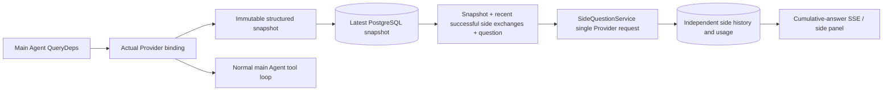

# ARTEX `/btw`

Regular chat, task MainAgent, and the current task's own Workers support independent side questions. Enter `/btw question` in the main input to submit one (replace the example placeholder with your question); an empty `/btw` or the “Side question” button opens the history. Desktop uses a resizable sidebar; mobile uses a Drawer.

Side answers are generated from the Agent context snapshot at submission time and support streaming, follow-up questions, stopping, and clearing. Closing the panel, refreshing the page, or disconnecting SSE does not cancel the model request. Stopping affects only the current side request; clearing cancels it and deletes the side-question history while retaining the main-context snapshot.

## Implementation boundaries

Uses Go, norma v0.3.7, Next.js, and the existing Markdown / ResizablePanel / Drawer / AlertDialog components. No norma source modifications or side-question dependencies were added. Planner, Workers inherited from other tasks, and upgrades to tool-driven subtasks are outside this implementation's scope.

- `capture.go` marks main-loop requests only through `Options.Deps.CallModel / CallModelSync`. The Provider decorator sits inside the concrete model, after selection by the outer routing pool, so it records the model actually chosen; compaction and summary requests do not overwrite the snapshot.
- Snapshots are published at request start, after a complete model response, and at the terminal run state. Partially generated responses are not published. Tool calls remain paired through norma's `MessagesForAPI`; tool results enter the snapshot at the next main-model request or terminal run state. Interrupted streams retain the last valid boundary.
- JSON deep copies preserve structured messages, system prompts, tool definitions, and generation parameters. Model inference holds neither a snapshot lock nor a database transaction.
- `SideQuestionService` calls the concrete Provider. It first generates a side-history summary if necessary. The final answer may be reduced and retried once only on the first context-overflow failure, before any text or tool call has been emitted. It creates no agent session and connects to no tool executor, main transcript, activity stream, or task graph; it also bypasses the task's model-switching chain. Answer requests retain tool definitions for compatibility with existing structured tool context; summary requests supply no tools. Newly returned tool calls have no execution path.
- One running request per parent session, at most four per service process, with a 120-second timeout per request. Side requests use independent cancellation contexts under the service lifecycle.
- Side requests retain model-configuration references and nonsensitive identity summaries; credentials are resolved from the existing configuration at request time. If a configuration is deleted, or identity fields such as model, protocol, or address change, the main Agent must run first to refresh the snapshot. Tests do not change the product's default model.

## Persistence and recovery

`db/schema.sql` automatically creates `side_question_sessions` and `side_question_requests`. The former stores the parent resource, latest snapshot, run ID, version, and clear generation; the latter stores the question, cumulative answer, status, model, snapshot time, usage, event sequence, and pagination ordinal.

Parent-session keys use the conversation ID, or task ID + exploration ID + intent ID. Workers are not named by reusable execution slots.

Snapshot writes are coalesced per parent session and flushed every 250 ms. The database compares `(run_id, version)` to prevent stale overwrites. The selected snapshot is saved again before side-question submission. Large in-memory snapshots are released after successful persistence; failed writes retain the pending version. Cumulative answers are written at most once every 250 ms as streaming events arrive. Terminal states are saved immediately, with bounded retries on database errors.

At service startup, leftover `running` requests become `interrupted`, retaining persisted partial answers and usage without automatically replaying requests. The latest successfully saved context can answer the next question directly. Old sessions without snapshots require a main-Agent run first; context is not reconstructed from UI activity logs.

Clearing increments the clear generation and deletes requests; conditional updates prevent late callbacks from restoring them. Physical parent deletion uses foreign-key cascades. Worker logical deletion removes side data in the same transaction and rejects subsequent late snapshots. Task archiving first blocks new requests, waits for the main flow to stop, then cancels side requests and waits for persistence. Archive format v3 remains compatible with v1/v2 archives that lack side-question tables.

History is retained in full, with ordinal-cursor pages of at most 20 entries. Model requests replay at most the 20 most recent successful exchanges verbatim, further restricted by the token budget; older exchanges have an independent rolling summary. If the main context exceeds the budget, only the older portion of the side copy is summarized, preserving recent structured tool calls and results. Summarization, preparation progress, and usage share the side request's concurrency, cancellation, and 120-second timeout limits. See [Context budgets and open-source references](CONTEXT_BUDGET.md).

## HTTP contract

The following paths serve as `{parent}`, retaining existing authentication and resource validation:

- `/api/conversations/{id}`
- `/api/tasks/{id}/chat`
- `/api/tasks/{id}/intents/{iid}`

| Request | Response and behavior |
| --- | --- |
| `GET {parent}/side-questions?before={ordinal}` | `items` newest first, separate `current` running state, `snapshot` metadata, and `next_cursor`; cursor 0 means the latest page / no next page |
| `POST {parent}/side-questions` | JSON `{ "question": "…", "client_request_id": "UUID" }`; a new request returns 202 and the request object; the same ID and question return the existing object with 200 |
| `DELETE {parent}/side-questions` | Cancel and clear side exchanges for the current parent session |
| `GET /api/side-questions/{requestID}/events` | `snapshot` SSE events: `id` is an increasing sequence and `data` is the complete cumulative request object; clearing sends `cleared` |
| `POST /api/side-questions/{requestID}/cancel` | Explicit cancellation; terminal state is available through history or SSE |

Questions are limited to 4000 characters. Missing snapshots, changed model configurations, a busy parent session, or conflicting idempotency IDs return 409; the global concurrency limit returns 429. Every SSE connection first sends cumulative state, without depending on text fragments previously received by the client. The frontend merges by request ID + sequence and discards stale callbacks when switching parent sessions or clearing history.

## Validation and references

See [VALIDATION.md](VALIDATION.md) for automated checks, actual model usage, and known limitations.

Independent requests were informed by [Grok CLI side-question.ts (pinned commit)](https://github.com/superagent-ai/grok-cli/blob/fb97af83f06dca873281d60168430f06c8de6324/src/utils/side-question.ts); execution isolation was informed by [OpenCode (pinned commit)](https://github.com/anomalyco/opencode/tree/b3f1a96c6dd7adeb28b36dd11add1998fc84d67b). ARTEX uses norma's structured messages for context rather than concatenating frontend log text.
