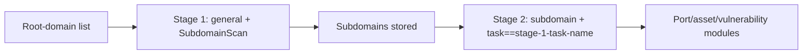

---

## name: scopesentry-mcp
description: Manage the security scanning platform (projects, tasks, templates, assets, nodes) through ScopeSentry MCP. Use when users mention ScopeSentry, MCP, API keys, scanning tasks, or asset queries.

# ScopeSentry MCP Usage Guide

For users with an **already deployed ScopeSentry instance**. Connect to the platform through Cursor (or another MCP client); no local source code is required.

## 1. Preparation

### 1.1 Verify Service Accessibility

- Default Web interface: `http://<host>`
- MCP endpoint: `http://<host>/mcp` (if behind a reverse proxy or frontend proxy, use the actual `/mcp` address)

### 1.2 Create an API Key

1. Log into the ScopeSentry Web interface in a browser
2. Open **API Key** management and create a key (or use an administrator-provided interface)
3. Save the returned `ssk_...` string (**shown only once**)

### 1.3 Configure Cursor MCP

Cursor → Settings → MCP → add a server:

```json
{
  "mcpServers": {
    "scopesentry": {
      "url": "http://<your-host>:8082/mcp",
      "headers": {
        "X-API-Key": "ssk_your-key"
      }
    }
  }
}
```

Alternatively use: `Authorization: Bearer ssk_your-key`

After configuration, restart MCP or reload Cursor and confirm tools such as `list_projects` and `list_assets` appear.

---

## 2. Tool Overview


| Tool | Purpose |
| ---------------------- | ----------------- |
| `list_projects` | Project tree grouped by tags (including project IDs) |
| `list_projects_data` | Paginated project list with name search |
| `get_project` | Project details |
| `create_project` | Create a project |
| `list_tasks` | Scanning task list |
| `get_task` | Task details |
| `list_scan_templates` | Scan template list |
| `get_scan_template` | Template details |
| `list_plugin_modules` | Scan pipeline module names |
| `list_plugins` | Available plugins (including hashes and default parameters) |
| `create_scan_template` | Create a scan template |
| `create_scan_task` | Create a scan task |
| `list_assets` | Query asset types (paginated lists) |
| `count_assets` | Count assets (`/api/assets/common/total`) |
| `get_asset_detail` | Asset or vulnerability details |
| `add_asset_tag` | Add an asset tag |
| `list_nodes` | Scanning node list |


Tool parameters follow the MCP tool descriptions (schemas); `list_assets` / `count_assets` share search and filter syntax. Read the `list_assets` description before querying assets.

To find the total count, use `count_assets` (the Web pagination total-count endpoint), rather than paging repeatedly through `list_assets` just to count.

---

## 3. Common Workflows

### 3.1 Query Assets by Project

When the user or context **already specifies a project**, prefer `filter.project` to narrow scope and avoid slow responses from excessive cross-project data. Do not require a project filter when no project is specified.

1. Use `list_projects` or `list_projects_data` to obtain the target project's **ObjectID** (`id` / `children[].value`)
2. Pass `filter.project` to `list_assets` (**must be an ID, not the project's Chinese display name**)

```json
{
  "asset_type": "asset",
  "pageIndex": 1,
  "pageSize": 20,
  "search": "domain=^example.com",
  "filter": {
    "project": ["<project-ObjectID>"]
  }
}
```

### 3.2 Create a Scan Task

1. Use `list_nodes` to obtain online node names
2. Use `list_scan_templates` or `create_scan_template` to obtain the template **ObjectID**
3. `create_scan_task`: `name` and `node` are required; `template` must be the template ID, not its name

**Target source `targetSource` (same as the Web interface):**

| targetSource | Description | Required Parameters |
| --- | --- | --- |
| `general` | Enter targets directly | `target` |
| `project` | Read targets from projects | `project` (array of project ObjectIDs) |
| `asset` | Search Web asset database | `search`; optional `project`, `filter`, `targetNumber` |
| `RootDomain` | Search root-domain database | `search`; optional `project`, `filter`, `targetNumber` |
| `subdomain` | Search subdomain database | `search`; optional `project`, `filter`, `targetNumber` |
| `UrlScan` | Search URL scan results | `search`; optional `project`, `filter`, `targetNumber` |
| `*Source` (such as `subdomainSource`) | Create from asset-page selection/search | Use `search` for `targetTp=search`; `targetIds` for `targetTp=select` |

**Example: directly scan root domains:**

```json
{
  "name": "example-subdomain-collection",
  "node": ["node-1"],
  "template": "<template-ObjectID>",
  "targetSource": "general",
  "target": "example.com\nfoo.com",
  "project": ["<project-ObjectID>"]
}
```

**Example: continue scanning from the subdomain database, filtered by the previous task name:**

```json
{
  "name": "example-ports-and-vulnerabilities",
  "node": ["node-1"],
  "template": "<follow-up-module-template-ObjectID>",
  "targetSource": "subdomain",
  "search": "task==\"example-subdomain-collection\"",
  "project": ["<project-ObjectID>"]
}
```

### 3.3 Full Root-Domain Reconnaissance (Two Stages Recommended)

For **root-domain** input and **complete information gathering**, use two scans rather than running the entire pipeline at once.

**Reason:** distributed tasks are assigned per **individual target**. When a node receives a root domain, subdomains discovered on that node also run subsequent modules there. This can cause uneven load, slow execution, and errors.

**Best practice:**

1. **Stage 1: subdomain collection only**
   - `targetSource`: `general`
   - `target`: all root domains (multiple lines)
   - Template: enable only `SubdomainScan` and `SubdomainSecurity` (subdomain scanning + subdomain takeover)
   - Use `get_task` to wait for completion

2. **Stage 2: subsequent modules**
   - `targetSource`: `subdomain`
   - `search`: `task=="<stage-1-task-name>"` (exact task-name match)
   - Optionally use `project` to narrow scope
   - Template: port scanning, asset mapping, vulnerability scanning, etc. (SubdomainScan can be omitted)
   - Subdomains are distributed as independent targets across nodes, improving parallelism

Alternatively, filter the Web interface's Subdomain asset page by task name and use "Create task from subdomains" for the same result.



### 3.4 Create a Scan Template

1. `list_plugin_modules` → module name list
2. `list_plugins` (optionally filter by `module`) → each plugin's `hash` and default `parameter`
3. `create_scan_template`: use `modules` to specify "module → array of plugin hashes"

---

## 4. Asset Queries (`list_assets` / `count_assets`)

`count_assets` and `list_assets` use the same `asset_type`, `search`, and `filter`; `count_assets` returns `{ "total": N }`, corresponding to the Web endpoint `/api/assets/common/total`.

```json
{
  "asset_type": "subdomain",
  "search": "task==\"some-task-name\"",
  "filter": {"project": ["<project-ObjectID>"]}
}
```

**Performance advice (both `list_assets` / `count_assets`):** prefer `filter.project` when a project is known. For indexed fields in `search`, prefer exact `==` or prefix `^` matches (see [4.3](#43-search-expressions)) rather than broad `=` fuzzy matching that slows responses. A project filter is not mandatory without project context.

Types supporting `filter.project` are listed in [4.4](#44-filter-exact-filtering).

### 4.1 Asset Types: `asset_type`

`asset`、`RootDomain`、`subdomain`、`app`、`mp`、`UrlScan`、`SensitiveResult`、`DirScanResult`、`crawler`、`vulnerability`、`PageMonitoring`、`IPAsset`、`SubdomainTakerResult`

Alias examples: `web`→asset, `vuln`→vulnerability, `ip`→IPAsset, `url`→UrlScan

### 4.2 Parameter Descriptions


| Parameter | Description |
| ------------------------ | --------------------------------------- |
| `pageIndex` / `pageSize` | Pagination; defaults 1 / 20 |
| `search` | Search expression (next section) |
| `filter` | Exact-filter JSON (next section) |
| `sort` | Only UrlScan and DirScanResult support sorting by `length` |
| `sid` | SensitiveResult only: sensitive-rule name |


`search` and `filter` **can be used together**.

### 4.3 search Expressions

Custom DSL (**not SQL**):


| Operator | Meaning | Index | Example |
| ---- | ---- | ---- | --------------------------- |
| `=` | Fuzzy match (regex) | No index | `domain=example` |
| `==` | Exact equality | **Uses index** | `port==443` |
| `!=` | Exclusion | — | `port!="80"` |
| `&&` | AND | — | `domain==example.com && port==443` |
| `||` | OR | — | `title=admin || body=login` |


**Indexes and operators:** fields such as `domain`, `ip`, `port`, and `title` are indexed, but only **exact `==` equality** or **prefix matching with values beginning with `^`** (such as `domain=^example.com`) can use indexes. **`=` becomes fuzzy regex matching and cannot use an index**, so large datasets can be slow.

**Search fields shared by all types:** `tag`, `task` (task name), `rootDomain`

**Do not put project in search** (invalid, or errors when combined with `&&`). Use `filter.project` to filter projects.

**Common search fields by type:**


| asset_type | Fields |
| -------------------- | ----------------------------------------------------------------------------------- |
| asset                | domain, ip, port, service, app, title, statuscode, icon, banner, type, body, header |
| RootDomain           | domain, icp, company                                                                |
| subdomain            | domain, ip, type, value                                                             |
| app                  | name, icp, company, category, description, url, apk                                 |
| mp                   | name, icp, company, category, description, url                                      |
| UrlScan              | url, input, source, resultId, type                                                  |
| SensitiveResult      | url, sname, body, info, md5                                                         |
| DirScanResult        | url, statuscode, redirect, length                                                   |
| vulnerability        | url, vulname, matched, request, response, level                                     |
| crawler              | url, method, body, resultId                                                         |
| PageMonitoring       | url, hash, diff, response                                                           |
| IPAsset              | ip, domain, port, service, webServer, app                                           |
| SubdomainTakerResult | domain, value, type, response                                                       |


**Search examples:**

- `domain==www.example.com && port==443` (exact equality; uses index)
- `domain=^example.com` (prefix match; uses index)
- `ip==192.168.1.1`
- `task=="some-task-name"`
- `level==high`（vulnerability）
- `statuscode==200`（DirScanResult）

Use `=` only when fuzzy containment is needed, such as `title=admin` (does not use indexes; combine with project or other conditions to narrow scope).

### 4.4 filter Exact Filtering

JSON object: multiple values under the same key use **OR**; different keys use **AND**.

**Prefer `project` when a project is known:** include it to narrow scope when the user/context identifies a project and asset_type supports it; not required when project information is absent.


| Filter Key | Meaning | Values |
| ------------ | -------- | -------------------------------------------------------- |
| `project` | Owning project | **ObjectID**, obtained from `list_projects` / `list_projects_data` |
| `task` | Source task | **Task name**, the `name` from `list_tasks` |
| `port` | Port | Such as `"443"` |
| `service` | Service/protocol | Such as `"https"` |
| `app` | Application fingerprint | Such as `"Nginx"` |
| `icon` | Icon hash | |
| `statuscode` | HTTP status code | Mainly for asset |
| `status` | Status | UrlScan/DirScan HTTP code; vulnerability/sensitive-information handling status |
| `level` | Vulnerability severity | critical / high / medium / low / info |
| `type` | Type | Such as subdomain record types A, CNAME |
| `color` | Sensitive-rule color | SensitiveResult |
| `sname` | Sensitive-rule name | SensitiveResult |
| `tags` | Tags | |


**Available filter keys by type:**


| asset_type                            | filter key                                                      |
| ------------------------------------- | --------------------------------------------------------------- |
| asset                                 | project, port, service, app, icon, statuscode, type, task, tags |
| RootDomain                            | project, tags                                                   |
| subdomain                             | project, type, task, tags                                       |
| app / mp                              | project, tags                                                   |
| UrlScan                               | status, tags                                                    |
| DirScanResult                         | status, tags                                                    |
| SensitiveResult                       | status, color, sname, tags                                      |
| crawler                               | project, task, tags                                             |
| vulnerability                         | project, level, status, task, tags                              |
| PageMonitoring / SubdomainTakerResult | tags                                                            |
| IPAsset                               | project, port, service, app                                     |


**Filter example:**

```json
{"project": ["<project-ObjectID>"], "port": ["443"]}
```

**Combined query example:**

```json
{
  "asset_type": "asset",
  "search": "domain=^baidu && port==443",
  "filter": {"project": ["<project-ObjectID>"]},
  "pageIndex": 1,
  "pageSize": 10
}
```

**Notes:**

- Prefer `filter.project` when a project is known (where supported); not mandatory without project context
- Do not put project display names in `filter.project`
- Use `==` for known values and `^` for prefixes; avoid excessive `=` fuzzy matching on large tables
- For UrlScan HTTP status, use `filter.status`; DirScanResult supports `statuscode==200` in search
- For SensitiveResult rule names, use `sname=rule-name` in `search`, or `filter.sname`

### 4.5 Sorting: sort

Supported only by **UrlScan** and **DirScanResult**:

```json
{"length": "ascending"}
```

Other types ignore `sort` and use default time-based ordering.

---

## 5. Scan Template Module Names

`TargetHandler`、`SubdomainScan`、`SubdomainSecurity`、`PortScanPreparation`、`PortScan`、`PortFingerprint`、`AssetMapping`、`AssetHandle`、`URLScan`、`WebCrawler`、`URLSecurity`、`DirScan`、`VulnerabilityScan`、`PassiveScan`

---

## 6. Troubleshooting


| Symptom | Action |
| --------- | -------------------------------------------------- |
| No MCP tools | Check URL, API key, and whether ScopeSentry is running |
| 401 / 403 | Recreate or replace the API key |
| Assets not found | Confirm `filter.project` is an ObjectID; do not put project in search |
| Template/task creation fails | `template` must be a template ObjectID; `node` must contain online node names |
| Query slow/stuck | Add `filter.project` when a project is known; use `==` or `^` prefix for indexed search fields, less `=`; reduce `pageSize` |


---

